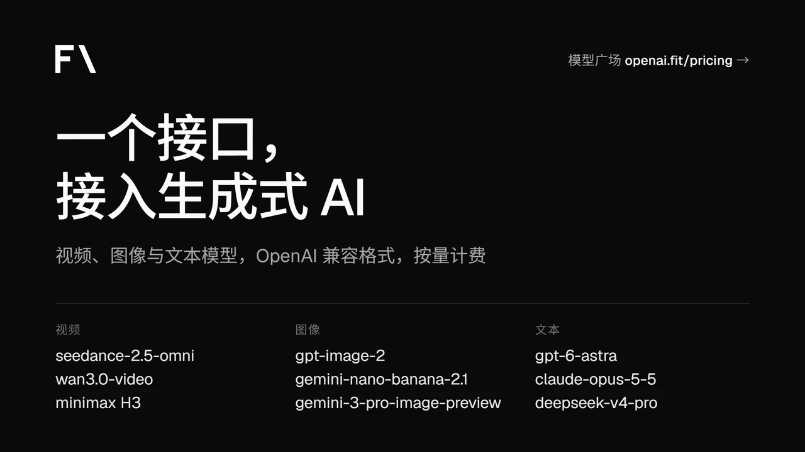
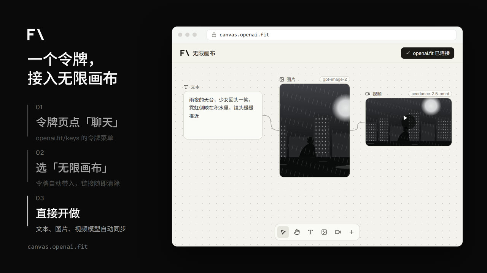

# InferStream 无限画布

此仓库公开 [InferStream 无限画布](https://canvas.inferstream.cn/) 的二次开发源码，采用 AGPL-3.0 许可证。当前发布包含 InferStream 单点登录、图片生成与参考图编辑接入。

- [线上源码发布目录](https://canvas.inferstream.cn/source/)
- [修改记录](MODIFICATIONS.md)
- [许可证](LICENSE)

---

以下为上游项目说明。

<p align="center">
  
</p>

<h1 align="center">无限画布 (infinite-canvas)</h1>

<p align="center">
  <a href="https://github.com/tigerowo/infinite-canvas"></a>
  <a href="VERSION"></a>
  <a href="LICENSE"></a>
  <a href="https://www.docker.com/"></a>
  <a href="https://nextjs.org/"></a>
  <a href="https://go.dev/"></a>
</p>

无限画布是一款面向图片，视频，音频，全能创作的开源工作台。它把画布编排、AI 图片、视频、音频生成、参考图编辑、对话助手、提示词库和素材沉淀放在同一个界面里，适合用来探索视觉方案并连续迭代图片结果

<p align="center">
  
</p>
<p align="center">
  
</p>

本项目基于 [basketikun(纯前端)](https://github.com/basketikun/infinite-canvas) 为底，合并 [HuFakai](https://github.com/HuFakai/infinite-canvas) 生图增强版基础上，针对视频和视频生成逻辑配置更加完善，完善后端云同步机制，不再依赖纯前端

本仓库是 openai.fit 为 canvas.openai.fit 维护的修改版，上游基线和改动见 [MODIFICATIONS.md](MODIFICATIONS.md)，源码获取方式见 [开源协议](docs/business/license.md)。

> [!CAUTION]
> 项目目前处于开发阶段，不保证历史数据兼容。各种数据库结构和存储格式都可能直接调整，欢迎关注后续更新
>
> 如果你需要稳定维护自己的分支，建议自行 fork 后独立开发。二次开发与 PR 请保留原作者信息和前端页面标识

## 核心功能

- Agent：围绕选中节点和上游节点分析、规划并生成图片或视频，支持选择 Skill 指导当前创作任务，并将结果插回画布
- 全景图：支持文字生成、参考图生成和本地 2:1 全景图导入，可作为导演台的场景环境背景
- 导演台：在独立 3D 场景中布置角色、模型、全景环境和机位，支持镜头管理、截图，并将机位画面自动发送为连线图片节点（导演台目前只有上游构建产物，见 [MODIFICATIONS.md](MODIFICATIONS.md)）
- 摄像机控制：图片、视频和生成配置节点支持独立设置相机、镜头、焦距和光圈，将镜头参数自动写入生成提示词，并随节点保存和复制
- 无限画布：多画布项目、节点拖拽缩放、连线、小地图、撤销重做、导入导出
- AI 创作：通过 openai.fit 使用文本、图片和视频模型，支持 Images API、Responses API、图生图、参考图编辑、流式接收、Base64 图片返回
- 生图工作台：支持侧边/悬浮底部工作台、多任务并发、历史结果合并展示、分类管理、失败详情、参考图缩略图、图片体积展示和“我的素材”复用
- 创作工作流：支持公开/个人模板、变量表单、单图/多图系列工作流、参考图输入和结果自动进入生图历史
- 提示词库：抓取多个 GitHub 开源项目，按案例整理数百个图片提示词
- 提示词与素材：提示词库、服务器素材库和“我的素材”可在生图、画布 AI 和工作流中复用

完整功能说明见 [docs/features.md](docs/overview/features.md)

## 技术栈

- 前端：Next.js、React、TypeScript、Tailwind CSS、Ant Design、Zustand、TanStack Query
- 后端：Go、Gin、GORM
- 存储：SQLite、本地 IndexedDB、S3 兼容对象存储、Cloudflare R2  
- 部署：Docker

## 快速开始

```bash
git clone https://github.com/tigerowo/infinite-canvas.git
cd infinite-canvas
cp .env.example .env
# 修改默认账号密码等信息
docker compose up -d --build
```

本地运行（下面两种方式）要先取消 `.env` 末尾「本机开发」段的注释（它把 `APP_ENV` 设成 `dev`，并把生产段的占位符换成开发值；`go run .` 和 `docker-compose.local.yml` 都要这样做），只改 `APP_ENV` 起不来。`APP_ENV` 只认 `dev` 和 `production`，不写就是 `production`：这时 JWT_SECRET、管理员账号密码不合要求会拒绝启动，而且必须配置 PUBLIC_HOST 和 SERVER_PUBLIC_IPS；写成其他值也会拒绝启动。

本地非 Docker 开发运行：
```bash
cp .env.example .env
# 取消 .env 末尾「本机开发」段的注释
go run .

# 另开一个终端窗口
cd web
bun install
bun run dev
```

本地源码构建运行：

```bash
cp .env.example .env
# 取消 .env 末尾「本机开发」段的注释
docker compose -f docker-compose.local.yml up -d --build
```

运行后默认端口3000，可访问 `http://localhost:3000`

如需要拉取提示词，可前往:`http://localhost:3000/admin/prompts`

## New API 自动配置

如果使用 New API，可在 `系统设置 -> 聊天方式 -> 添加聊天设置` 中填入：

```text
https://canvas.openai.fit/#apiKey={key}&baseUrl={address}
```

在令牌列表点「聊天」跳转后，画布先显示打码的令牌、令牌名称和到期时间，确认后才导入令牌并同步模型。参数必须放在 `#` 后面，不会发到画布服务器；写成 `?apiKey=` 的链接会被忽略并从地址栏抹掉。本站只接受 openai.fit 的令牌，`baseUrl` 不是 openai.fit 时会被忽略。
如果自己部署了，可以把 `https://canvas.openai.fit` 替换成你部署的地址。

## 效果展示

<table width="100%">
  <tr>
    <td width="50%"></td>
    <td width="50%"></td>
  </tr>
  <tr>
    <td width="50%"></td>
    <td width="50%"></td>
  </tr>
  <tr>
    <td width="50%"></td>
    <td width="50%"></td>
  </tr>
  <tr>
    <td width="50%"></td>
    <td width="50%"></td>
  </tr>
  <tr>
    <td width="50%"></td>
    <td width="50%"></td>
  </tr>
  <tr>
    <td width="50%"></td>
    <td width="50%"></td>
  </tr>
</table>

## 文档

- [功能介绍](docs/overview/features.md)
- [部署说明](docs/overview/docker.md)
- [画布节点操作手册](docs/canvas/canvas-node-manual.md)
- [画布快捷键](docs/canvas/canvas-shortcuts.md)
- [待办事项](docs/progress/todo.md)
- [后端数据库说明](docs/backend/backend-database.md)
- [系统配置数据结构](docs/backend/system-settings.md)
- [接口响应约定](docs/backend/api-response.md)

## 开源协议

本项目使用 GNU Affero General Public License v3.0，见 [LICENSE](LICENSE)。
